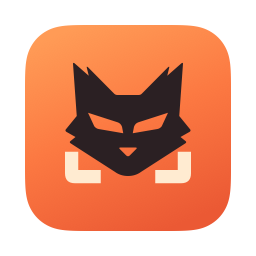
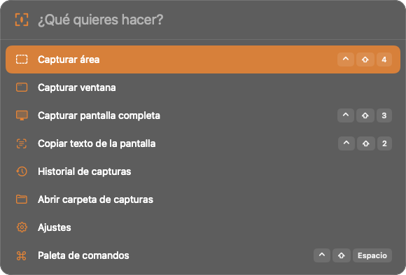
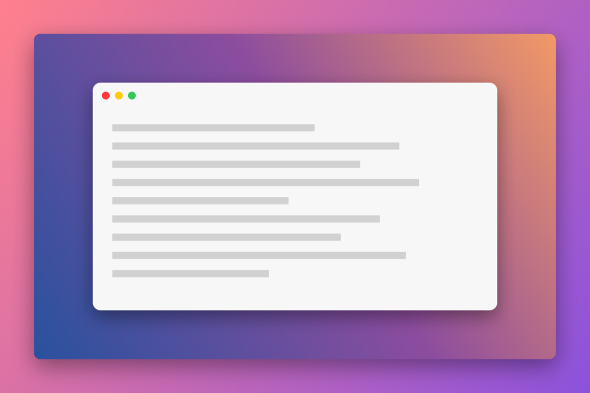

<p align="center">
  
</p>

<h1 align="center">Lince</h1>

<p align="center">
  Capturas y grabaciones de pantalla para macOS, nativa, rápida y de código abierto.
</p>

Lince vive en la barra de menús. Capturas un área, una ventana o la pantalla entera, y el resultado aparece como una miniatura flotante desde la que lo copias, lo guardas, lo arrastras a otra app o lo editas. También graba la pantalla en vídeo o GIF.

Está escrita en Swift con AppKit, sin dependencias externas. Todo se queda en tu Mac: no hay cuentas, ni nube, ni telemetría.

<p align="center">
  
</p>

## Qué hace

**Capturar**

- Área, ventana o pantalla completa, con lupa para afinar al píxel.
- La selección se pega a los bordes de las ventanas (con ⌘ pulsado, no).
- Las ventanas se capturan con sus esquinas transparentes y, si quieres, con sombra.
- Temporizador de 3, 5 o 10 segundos y repetición de la última área.
- Copiar el texto de cualquier zona de la pantalla (OCR, sin conexión).

**Grabar**

- Vídeo MP4 o GIF de un área, una ventana o la pantalla completa.
- Cursor, ondas en cada clic, sonido del Mac y micrófono, todos opcionales.
- Pausa, cuenta atrás y un botón de parar en la barra de menús.
- Cambia entre MP4 y GIF después de grabar, sin repetir la grabación.
- Codificador de GIF propio: solo guarda lo que cambia en cada fotograma, así que pesa poco.

<p align="center">
  
</p>

**Después de capturar**

- Bandeja de miniaturas apiladas: copiar, guardar, arrastrar, fijar en pantalla o descartar deslizando.
- Exportación en PNG, JPG o HEIC, a tamaño original, a la mitad o con un ancho a medida.
- Editor con flechas, formas, texto, numeración, resaltador y pixelado.
- Fondos con degradado, margen, esquinas redondeadas y sombra, con colores sacados de la propia captura.
- Historial de las últimas capturas y almacén de las últimas grabaciones.

<p align="center">
  
</p>

**Además**

- Paleta de comandos con todas las acciones.
- Atajos globales configurables; puede sustituir a ⌘⇧3 y ⌘⇧4 de macOS.

## Atajos por defecto

| Acción | Atajo |
| --- | --- |
| Capturar área | ⌃⇧4 |
| Capturar pantalla completa | ⌃⇧3 |
| Copiar texto de la pantalla | ⌃⇧2 |
| Repetir última área | ⌃⇧5 |
| Grabar la pantalla / detener | ⌃⇧6 |
| Paleta de comandos | ⌃⇧Espacio |

Se cambian en Ajustes › Atajos.

## Requisitos

- macOS 14 o posterior. El micrófono en las grabaciones necesita macOS 15.
- Para compilar: Xcode o las herramientas de línea de comandos, con Swift 5.9 o posterior.

## Compilar

```bash
git clone https://github.com/mdbep/lince.git
```

```bash
cd lince
```

```bash
scripts/build-app.sh --install
```

El script compila, genera `dist/Lince.app` y `dist/Lince.dmg`, copia la app a `/Applications` y la abre. Sin `--install` solo compila y empaqueta.

Firma con la primera identidad «Apple Development» que encuentre en el llavero, o ad hoc si no hay ninguna. Con firma ad hoc macOS vuelve a pedir el permiso de grabación de pantalla tras cada compilación. Para usar otra identidad:

```bash
SIGN_IDENTITY="Developer ID Application: Tu Nombre (XXXXXXXXXX)" scripts/build-app.sh
```

## Permisos

- **Grabación de pantalla:** imprescindible. Lince lo pide la primera vez y te guía en la pantalla de bienvenida.
- **Micrófono:** solo si activas «Grabar el micrófono» en una grabación.

## Estructura

Todo el código está en `Sources/Lince`:

| Archivo | Qué contiene |
| --- | --- |
| `AppDelegate.swift` | Menú de la barra, atajos y el flujo de captura |
| `ScreenCapturer.swift` | Captura de pantallas y ventanas con ScreenCaptureKit |
| `SelectionOverlay.swift` | Selección de área y de ventana, lupa e imán |
| `Thumbnail.swift` | Bandeja de miniaturas |
| `Editor.swift`, `Annotation.swift`, `Backdrop.swift` | Editor, anotaciones y fondos |
| `Recording.swift`, `RecordingUI.swift` | Grabación de vídeo y sus controles |
| `GIFEncoder.swift` | Codificador de GIF |
| `CommandPalette.swift`, `SettingsWindow.swift`, `Shortcuts.swift` | Paleta, ajustes y atajos |
| `Snapshot.swift`, `RecordingChecks.swift` | Comprobaciones internas |

### Comprobaciones

No hay un objetivo de pruebas aparte. El propio ejecutable tiene un modo que renderiza cada pantalla a PNG y escribe un informe con los resultados de exportación, OCR, GIF y vídeo:

```bash
LINCE_HISTORY_DIR=/tmp/lince-check/hist "$(swift build -c release --show-bin-path)/Lince" --snapshot /tmp/lince-check
```

## Estado

Lince es un proyecto joven (versión 0.1.0). Lo que falta, por si quieres echar una mano:

- Recortar y editar las grabaciones.
- Las grabaciones todavía no aparecen en el historial.
- Compilación notarizada para descargar sin avisos de macOS.
- La interfaz está solo en español.

## Licencia

[MIT](LICENSE).
