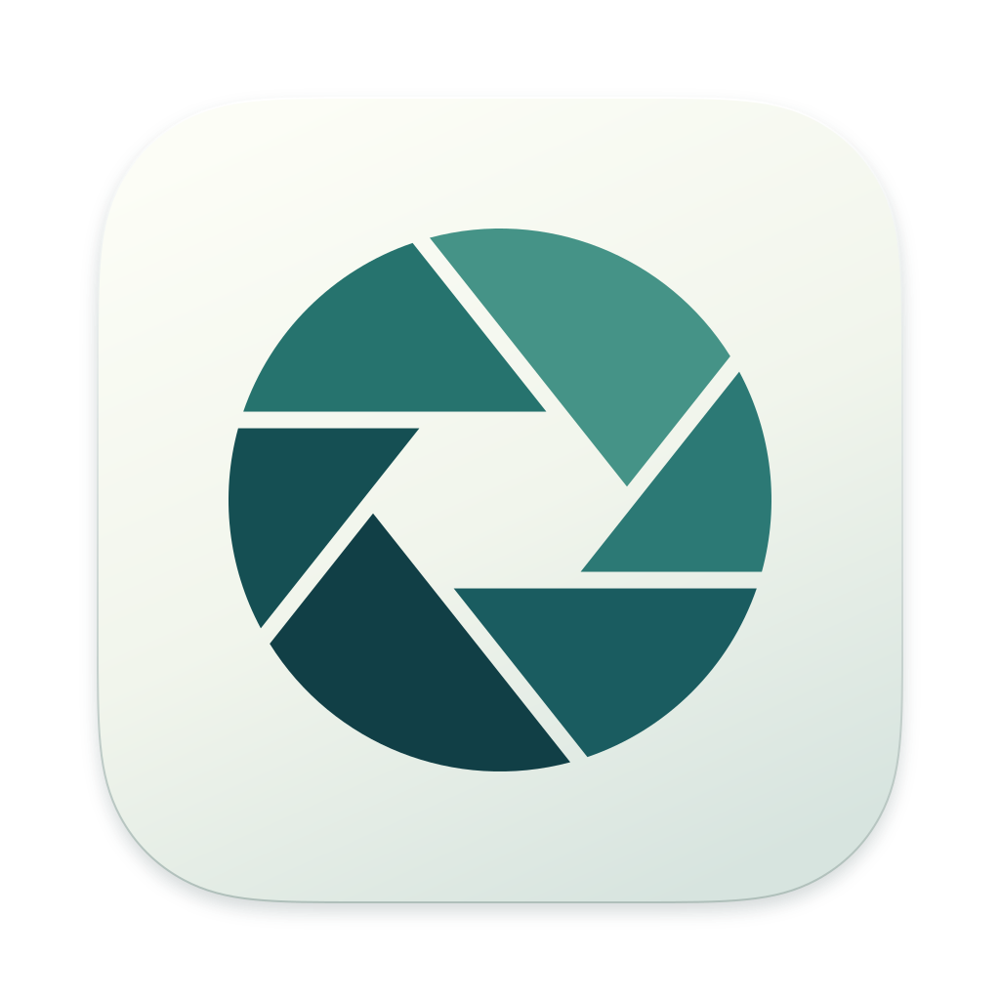

# Lince icon concepts

| [Night Sight](icon-1.svg) | [Field Mask](icon-2.svg) | [Glass Shutter](icon-3.svg) | [Drag to Capture](icon-4.svg) | [Window Flash](icon-5.svg) |
| :---: | :---: | :---: | :---: | :---: |
|  |  |  |  |  |
| [Menu bar SVG](menubar-1.svg) | [Menu bar SVG](menubar-2.svg) | [Menu bar SVG](menubar-3.svg) | [Menu bar SVG](menubar-4.svg) | [Menu bar SVG](menubar-5.svg) |

## 1 · Night Sight

Two ivory viewfinder corners (`#F3E8D5`) frame a lynx eye. Amber (`#FFC171`) grades into Lince orange (`#F57D21`) against graphite (`#34424A` to `#182128`). The slit pupil cuts through to the tile, leaving two broad orange shapes that keep the eye legible at 16 pixels.

## 2 · Field Mask

The lynx’s ear tufts mark the upper corners of a capture area, and two ivory brackets (`#FFEBD1`) finish the lower corners. An ink silhouette (`#2B2023`) sits on apricot (`#FF9B56`) shading to vermilion (`#EB5934`). The high ear tips, wide cheek ruffs, and two angled eye openings carry the expression at Dock size.

## 3 · Glass Shutter

Six shutter blades turn around a wide hexagonal opening, giving the aperture the proportions of a narrowed eye. The blades range from deep petrol (`#113F46`) to sea glass (`#459387`) on porcelain (`#FCFDF6` to `#D7E4DF`). The light opening stays distinct at 16 pixels, and wider gaps keep the blades separate in the black menu bar glyph.

## 4 · Drag to Capture

A butter-yellow pointer (`#FFE9AD` to `#FFD180`) occupies the open corner of a pearl selection frame (`#F9F6FF`) on periwinkle and indigo (`#7468F0` to `#373396`). Three broad frame segments suggest a selection marquee. The break around the arrowhead keeps the pointer and the selected area distinct at small sizes.

## 5 · Window Flash

An ivory four-point flash (`#FFFCE8`) crosses the sill of a forest-green window (`#22372B`) on citron (`#EEFA97` to `#C8E45F`). Three round controls identify the macOS window at larger sizes. At 16 pixels, the horizontal title bar and the bright break in the lower edge carry the idea of capturing a window.
